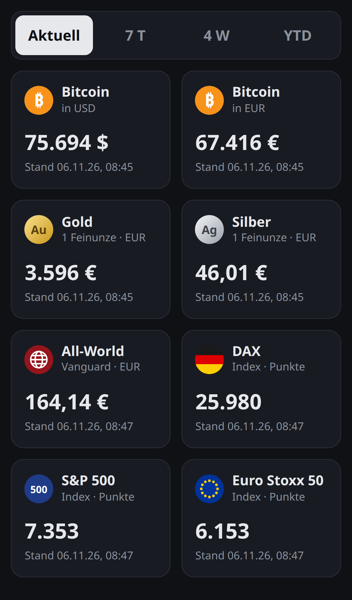
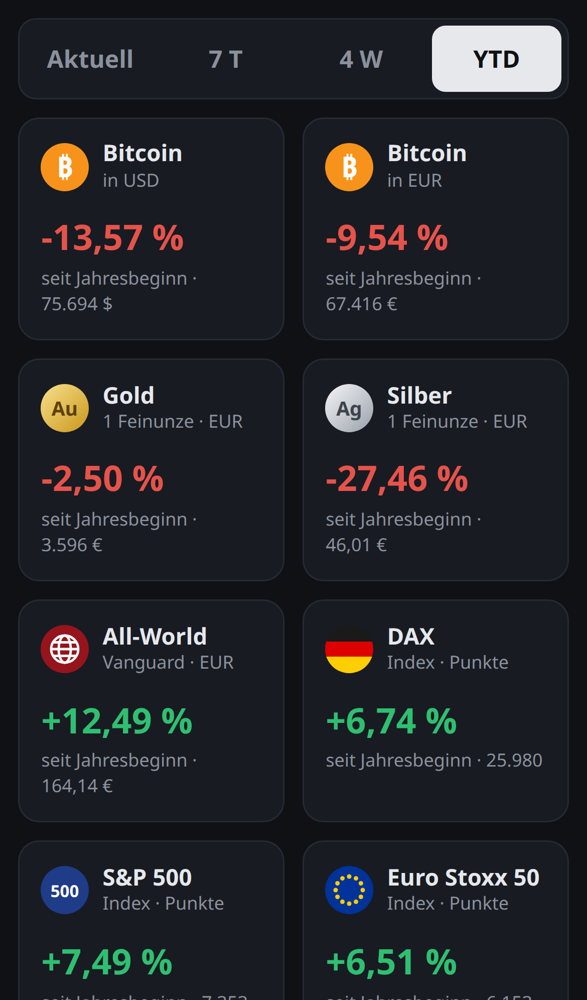

# hodl-helper

Statische, mobil optimierte Seite (Vanilla JS, kein Backend) mit Kursen und Performance.
Oben wählen vier Buttons die Ansicht: **Aktuell** (Preis), **7 T**, **4 W**, **YTD** (Veränderung in %).

| Kachel | Quelle | Hinweis |
|---|---|---|
| Bitcoin USD, Bitcoin EUR | CoinGecko `market_chart` | |
| Gold (EUR, 1 oz) | CoinGecko, Token PAX Gold (PAXG) | 1 Token = 1 Feinunze, weicht minimal vom Spotpreis ab |
| Silber (EUR, 1 oz) | CoinGecko, Token Kinesis Silver (KAG) | 1 Token = 1 Feinunze, weicht minimal vom Spotpreis ab |
| Vanguard FTSE All-World (VWCE) | onvista Snapshot-API | Performance von onvista vorberechnet |
| DAX, S&P 500, Euro Stoxx 50 | onvista Snapshot-API | Stand in Punkten; außerhalb der Handelszeiten Indikation der Banken |

Beide APIs senden `Access-Control-Allow-Origin: *`, der Browser ruft sie direkt auf.
Aktualisierung alle 5 Minuten und beim Zurückkehren in den Tab.

| Aktuell | YTD |
|---|---|
|  |  |

## Lokal starten

```sh
python3 -m http.server 8000
# http://localhost:8000
```

## Netlify

Site aus diesem Repo anlegen (*Add new site → Import an existing project*), Branch `main`.
Build command und Publish directory kommen aus `netlify.toml`: kein Build, das Repository-Root wird
1:1 ausgeliefert. Jeder Push auf `main` löst ein Deploy aus.

## Einschränkungen

- CoinGecko (Public API, ohne Key) liefert max. 365 Tage Historie und hat ein Rate-Limit von wenigen Requests pro Minute.
- Die onvista-API ist nicht offiziell dokumentiert und kann sich ändern. Laut onvista-AGB ist die Nutzung der Inhalte eingeschränkt – für mehr als den Privatgebrauch eine lizenzierte Quelle verwenden.
